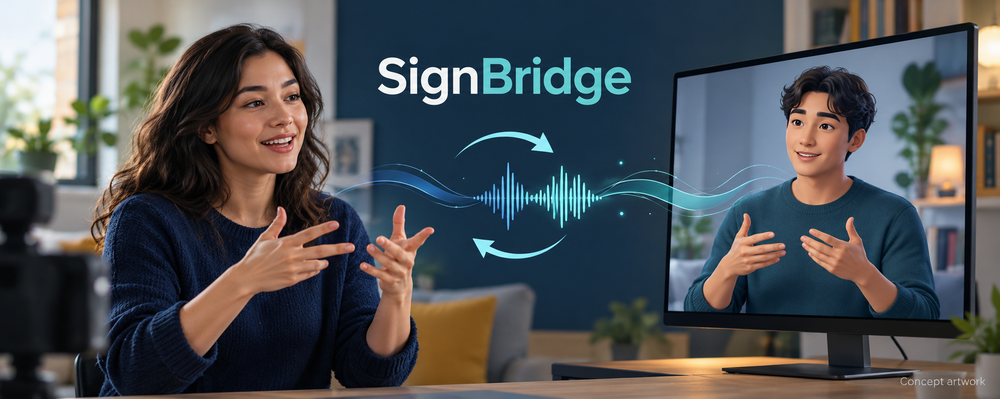
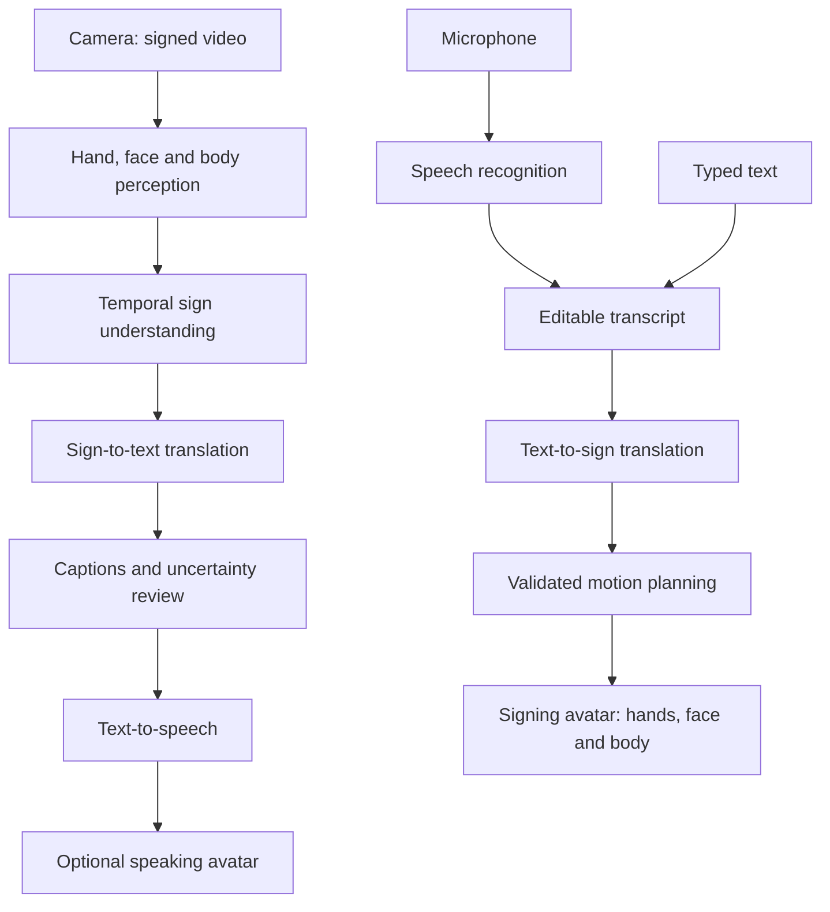

# SignBridge

### Deep Learning · Real-time Sign Language ↔ Speech & Avatar Accessibility Agent



> **Status: concept and development blueprint.** This repository currently contains documentation and concept artwork, not a trained model or working translation application. Real-time operation, visual accuracy, and translation quality are goals that must be validated.

SignBridge proposes a two-way communication assistant for Deaf, hard-of-hearing, and hearing people. A camera captures signing for translation into captions and synthesized speech, optionally delivered through a speaking avatar. In the reverse direction, speech or typed text is translated into a selected sign language and presented by a signing avatar with coordinated hands, body, gaze, and facial expressions.

## Is this an ML, DL, or GenAI project?

**Primary classification: Deep Learning (DL), within Machine Learning (ML).** Video understanding, temporal sign recognition, translation, and speech recognition are intended to use neural models. Generative AI may support language processing or motion synthesis in later research, but is optional and does not establish linguistic accuracy.

**Repository name:** `DL-SignBridge`  
**Project title:** **Deep Learning — SignBridge Accessibility Agent**

| Area | Proposed approach | Role |
| --- | --- | --- |
| Visual perception | Neural hand, face, and body landmark detection or video encoders | Capture movement and non-manual signals |
| Sign understanding | Temporal neural models, such as Transformers | Model signs in context across frames |
| Translation | Language-specific sequence models | Translate meaning between different languages |
| Speech input/output | Automatic speech recognition and text-to-speech | Convert audio to text and text to voice |
| Signing avatar | Validated motion library first; learned motion later | Render signs with correct timing and expressions |
| Optional GenAI | Constrained language or motion generation | Research extension requiring review |

No model, provider, dataset, or performance result has been selected or implemented yet.

## Problem and intended users

Communication barriers arise when participants use different languages or modalities and an interpreter is unavailable. SignBridge explores accessible conversational assistance for everyday interactions, learning, and service desks. It should be developed with Deaf signers and sign-language experts from the beginning.

Sign languages are distinct natural languages, with their own grammar and regional variation. They are not universal hand encodings of spoken words. The first prototype should explicitly select one pair—for example, **American Sign Language (ASL) and English**—before training or collecting data. ASL–English is a proposed initial scope, not current support.

## Planned experiences

### 1. Sign language to captions, speech, and a speaking avatar

1. The user chooses a supported sign language and consents to camera capture.
2. The application checks framing, visibility, and lighting.
3. A visual model processes hands, face, body, and motion over time.
4. A temporal model recognizes or translates signed content into text.
5. Captions appear for review; uncertain content triggers clarification.
6. Confirmed text can be read aloud or delivered by a lip-synchronized speaking avatar.

### 2. Speech or text to a signing avatar

1. The user types text or enables microphone capture.
2. Speech recognition produces an editable transcript.
3. Translation maps the intended meaning into the target sign language.
4. A motion planner selects validated signs, transitions, timing, and non-manual features.
5. An avatar renders the message, with replay, pause, and speed controls.
6. Missing vocabulary or unsupported messages produce an explicit fallback instead of invented signs.

A speaking avatar and a signing avatar serve different purposes. Lip movement alone does not translate spoken language into a sign language.

## Proposed architecture



### Candidate implementation stack

These are options to evaluate, not installed dependencies or guarantees of compatibility.

| Layer | Candidate technology | Decision criteria |
| --- | --- | --- |
| Accessible client | TypeScript and React | Keyboard access, captions, clear media controls |
| Video capture | Browser camera APIs | Explicit permissions and device compatibility |
| Landmark extraction | MediaPipe or an equivalent vision model | Tracking quality and on-device feasibility |
| Model training | Python and PyTorch | Reproducible training and evaluation |
| Inference service | FastAPI; streaming transport if justified | Latency, throughput, and privacy |
| Avatar renderer | Three.js and a rigged 3D avatar | Finger articulation and facial control |
| Speech | Local or hosted ASR/TTS | Language coverage, latency, consent, and cost |
| Model deployment | ONNX Runtime or server inference | Measured performance on target hardware |

## Development roadmap

- [ ] **Define the scope:** choose a language pair, consult Deaf collaborators, and define vocabulary and intended settings.
- [ ] **Build an accessible shell:** camera preview, editable captions, transcript review, and avatar playback controls.
- [ ] **Create a bounded recognition baseline:** evaluate a small vocabulary before attempting unrestricted conversation.
- [ ] **Add continuous signing:** handle sign boundaries, sentence context, and uncertainty.
- [ ] **Build speech-to-sign playback:** start with linguist-reviewed motion clips and explicit unsupported-content handling.
- [ ] **Integrate both directions:** measure end-to-end delay and evaluate complete conversations.
- [ ] **Validate with users:** publish limitations and results for the selected language, hardware, and population.
- [ ] **Explore motion generation:** only after establishing comprehensibility and quality baselines.

## Data and training plan

- Select datasets with documented language, consent, permitted uses, and license terms. No training data is included here.
- Record signer diversity, dialect, lighting, camera placement, clothing, occlusion, and annotation quality.
- Keep signers separate across training, validation, and test sets to reduce identity leakage.
- Preserve temporal context and facial information where consent permits; hand landmarks alone may omit linguistic information.
- Document preprocessing, normalization, augmentations, vocabulary, splits, model settings, and random seeds.
- Compare simple bounded baselines with richer temporal models before increasing complexity.
- Publish dataset and model documentation, known gaps, and access restrictions before releasing weights.

## Accuracy, visuals, and evaluation

**No accuracy, latency, or comprehension scores are available.** A convincing animation is not evidence of correct translation. Evaluation should distinguish recognition, translation, avatar comprehensibility, and usability.

| Dimension | Proposed measurement |
| --- | --- |
| Isolated sign recognition | Per-class precision, recall, F1, and confusion matrix |
| Continuous recognition | Gloss sequence error rate where gloss annotations are appropriate |
| Meaning preservation | Human judgments by fluent signers and bilingual reviewers; automated text metrics as supporting evidence |
| Signing avatar quality | Comprehension, handshape, orientation, location, motion, facial grammar, and transitions |
| Real-time behavior | End-to-end median and p95 delay, frame rate, and dropped frames on named devices |
| Robustness | Results across unseen signers, dialects, camera conditions, and occlusion |
| Uncertainty | Calibration, rejection behavior, and clarification frequency |
| Accessibility | Keyboard and screen-reader testing, caption readability, and user task completion |

Set numerical targets with collaborators after baseline measurement. Report the full evaluation setup and subgroup gaps rather than a single headline accuracy number.

## Accessibility and responsible design

- Make camera and microphone use explicit, revocable, and visible.
- Prefer on-device processing where feasible; document every remote processing path.
- Do not retain video, audio, or transcripts by default. Any recording should require separate consent and a stated retention period.
- Support editable text, visible uncertainty, replay, adjustable avatar speed, and text fallback.
- Maintain clear facial and hand visibility, including contrast and adequate rendering size.
- Avoid presenting unverified translations as authoritative. This concept is not a validated substitute for qualified interpreters in critical interactions.
- Review outputs with Deaf collaborators and compensate their expertise.
- Treat camera, face, and voice data as sensitive; keep credentials and personal media out of public commits.

## Repository contents

```text
DL-SignBridge/
├── README.md                         # Project overview and development blueprint
├── .gitignore                        # Excludes secrets, environments and private media
└── docs/
    ├── artwork.md                    # Cover provenance and generation prompt
    └── assets/
        └── signbridge-cover.png      # AI-generated concept artwork
```

## Getting started

This is a documentation-first repository. There is no application to install, model to download, or training command to run yet.

```bash
git clone https://github.com/vams2krish/DL-SignBridge.git
cd DL-SignBridge
```

Begin by selecting the language pair and recording a small, measurable prototype scope. Future implementation should add verified setup instructions, dependency versions, tests, and a reproducible demo alongside the relevant code.

## Contributing

Contributions from Deaf community members, sign-language linguists, accessibility practitioners, animators, and ML engineers are welcome. Open an issue describing the language, use case, evidence, and expected outcome before proposing a major change. Do not upload recordings of other people without their permission or data without redistribution rights.

## Research and technical references

- [Sign Language Recognition, Generation, and Translation: An Interdisciplinary Perspective](https://www.microsoft.com/en-us/research/wp-content/uploads/2019/07/Sign_Language_Workshop_Camera_accessible.pdf) — linguistic context and the distinction between recognition, translation, and production.
- [U.S. Deaf Community Perspectives on Automatic Sign Language Translation](https://www.microsoft.com/en-us/research/uploads/prod/2023/10/Automatic_Sign_Language_Translation_Perspectives.pdf) — community perspectives to inform participatory design.
- [MediaPipe HolisticLandmarker API](https://developers.google.com/edge/api/mediapipe/python/mp/tasks/vision/HolisticLandmarker) — a candidate perception component; landmark detection itself does not translate sign language.

## License and assets

No open-source license has been selected yet. Public visibility alone does not grant a license to reuse the repository. Dataset, model, avatar, and motion asset licenses must be reviewed separately before they are added. The cover is AI-generated concept artwork, not an application screenshot or instructional sign-language reference.
