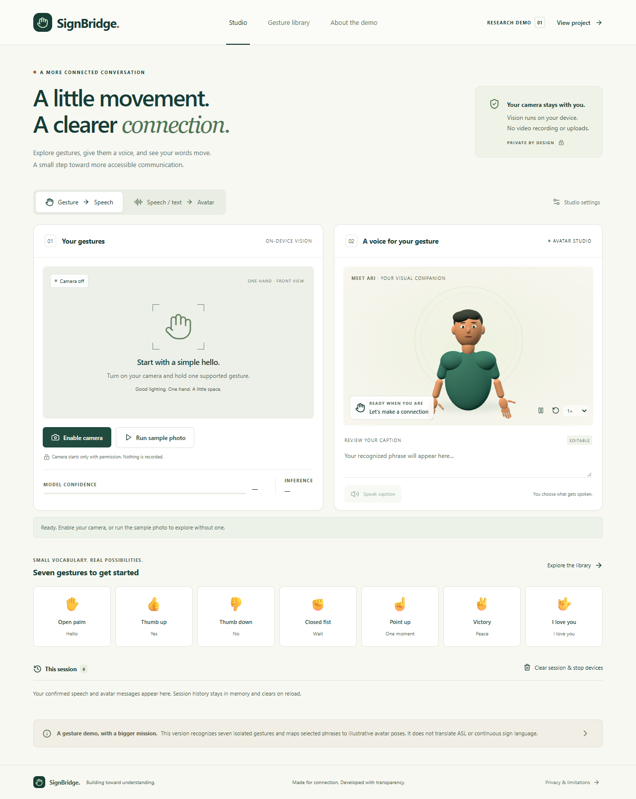
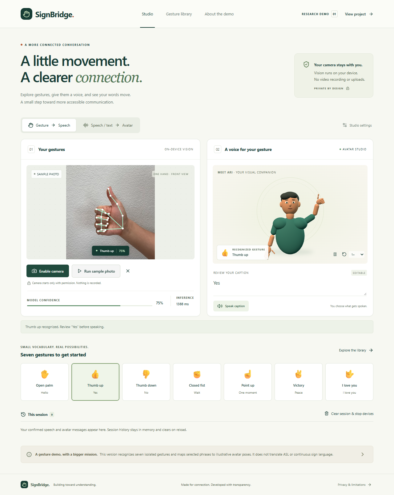
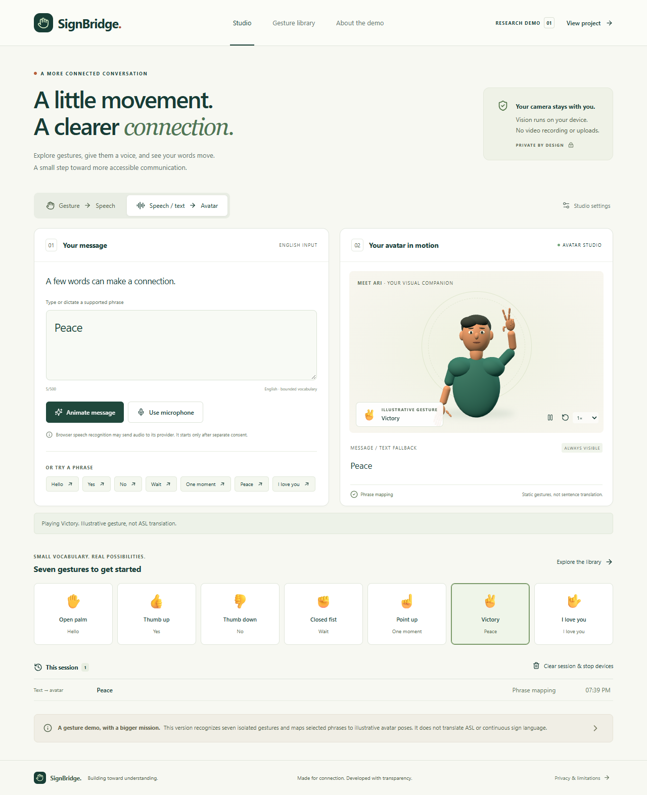
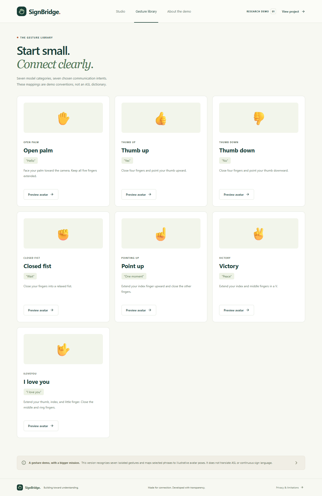
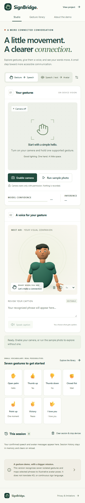
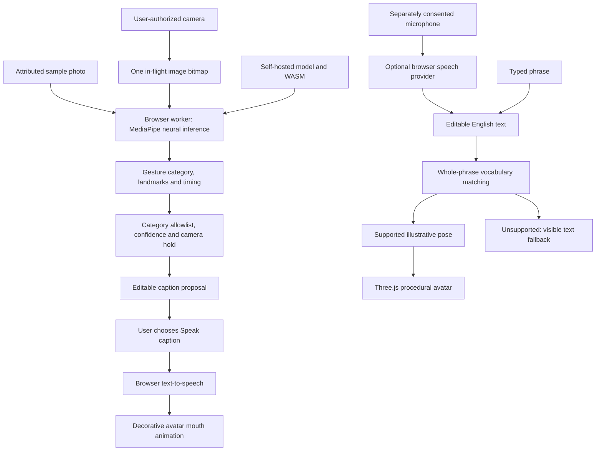

# SignBridge — Deep Learning Accessibility Studio

**Gesture → captions & speech · Speech/text → illustrative avatar**

A working browser demo that explores two-way accessible communication with on-device deep learning, editable captions, and a 3D companion named Ari.

**[Open the live demo](https://signbridge-gesture-lab.adam-vamshikrishna.chatgpt.site)** · Hosted privately through Sites; sign in with the owning account. The source repository remains public.

> **Release scope:** deployable research demo, not a production-ready sign-language interpreter. This version recognizes **seven isolated hand gestures** and maps a bounded set of English phrases to illustrative avatar poses. It does not translate ASL, continuous signing, or arbitrary sentences. No translation-accuracy claim is made.

## Product showcases

These are actual screenshots of the implemented application. The original AI-generated cover remains in [concept artwork](docs/artwork.md).

### 1. The studio

Permission-based camera input, local vision, editable captions, speech controls, and a 3D avatar in one workspace.



### 2. Real model recognition

The sample button runs the actual MediaPipe model on an attributed test photograph. A thumb-up classification proposes “Yes” for review. The confidence shown is a model score, not measured accuracy; the inference time is specific to the test device and excludes capture, holding, review, and speech.



### 3. Text to avatar

“Peace” selects the illustrative Victory pose. The avatar has articulated fingers, a procedural upper body, adjustable idle motion, and decorative mouth movement during speech. These motions are not linguist-validated sign-language animations.



### 4. The supported gesture library

Each category includes a pose hint, chosen communication intent, and avatar preview. The chosen phrases are demo conventions, not an ASL dictionary.



### 5. Mobile layout

The studio stacks its input and output panels on smaller screens, with the same consent, fallback, and caption controls. Browser support for camera, speech recognition, and WebGL varies; physical mobile-device validation remains pending.



## What works now

| Capability | Implementation and boundary |
| --- | --- |
| Live gesture recognition | Self-hosted MediaPipe neural model, CPU inference in a browser worker, one hand at a time |
| Temporal proposal filtering | Default 70% model-score threshold, 650 ms confident camera hold, release-based repeat suppression |
| Sample without camera | Real inference on Google's attributed thumb-up test photo; no synthetic prediction |
| Caption review | Editable caption, user-triggered text-to-speech, stop speaking, voice selection |
| Speech input | Optional browser speech recognition with separate consent and editable transcript |
| Text/speech to avatar | Whole-phrase matching against seven supported intents; unsupported text remains visible |
| Avatar | Procedural Three.js character with articulated fingers and seven illustrative static gesture poses |
| Privacy controls | No application recording, upload, analytics, backend, or persistent conversation storage |
| Session history | Confirmed speech and avatar messages in memory, capped at 20; clear session also stops devices |
| Accessibility | Semantic controls, native modal dialogs, visible focus, live status, reduced-motion option, text fallback |
| Evaluation tooling | Local image-manifest harness with declared signer separation, duplicate detection, confusion matrix and latency |
| Verification | Unit tests, browser integration tests, accessibility scan, production build, dependency audit, GitHub Actions workflow |

Browser speech recognition may send audio to its provider. TTS voices can be local or remote; local voices are labeled. Camera processing stays on the device. Hiding the page, switching the app view/direction, or clearing the session stops active capture and speech.

## Is it ML, DL, or GenAI?

**Primary classification: Deep Learning (DL), a subset of Machine Learning (ML).** The shipped visual recognition uses pretrained MediaPipe neural networks. Temporal confidence filtering and phrase mapping are deterministic application logic. The avatar is procedural animation. There is no LLM, generative translation model, or OpenAI API dependency.

The long-term project remains **Deep Learning — SignBridge Accessibility Agent**, with ASL–English translation as a proposed future research direction. Actual language scope must be agreed with Deaf collaborators and sign-language specialists; seven hand categories do not establish support for a natural sign language.

## Try it locally

Requirements: **Node.js 24**, npm, an internet connection for the initial dependency/model download, and a current desktop Chromium browser. Camera access requires HTTPS or localhost. Text input and captions remain available if optional speech APIs are unsupported.

```bash
git clone https://github.com/vams2krish/DL-SignBridge.git
cd DL-SignBridge/app
npm ci
npm run assets
npm run dev
```

Open the Local URL printed by Vite, normally `http://127.0.0.1:5173/`. No API key or account database is needed. Model and WASM assets are self-hosted after preparation; there is no service-worker/offline-install guarantee.

### Walk through both directions

1. Choose **Run sample photo**. Wait for the real model to propose **Yes**.
2. Edit the caption if needed, then choose **Speak caption**. Choose an installed voice under **Studio settings** if necessary.
3. To use a camera, choose **Enable camera**, review consent, then grant browser permission. Hold one supported gesture steady until a proposal appears. Review before speaking.
4. Switch to **Speech / text → Avatar**. Type **Peace** or select a phrase and choose **Animate message**.
5. Optionally choose **Use microphone**, review its separate privacy notice, dictate a supported phrase, and review the transcript before animating it.
6. Try an unsupported sentence: the app preserves the text and declines to invent a gesture.
7. Use **Clear session & stop devices** to stop camera, microphone, and speech and clear session content.

## Supported demo vocabulary

| Model category | Demo phrase | Reverse-input aliases |
| --- | --- | --- |
| `Open_Palm` | Hello | hello, hi, open palm |
| `Thumb_Up` | Yes | yes, thumb up, thumbs up |
| `Thumb_Down` | No | no, thumb down, thumbs down |
| `Closed_Fist` | Wait | wait, fist, closed fist |
| `Pointing_Up` | One moment | one moment, point up, pointing up |
| `Victory` | Peace | peace, victory |
| `ILoveYou` | I love you | i love you |

Matching is case-insensitive and ignores common punctuation; it requires the complete supported phrase. For example, “No thanks” is unsupported even though “No” is supported. Manual library previews are explicitly labeled and do not create camera-recognition results.

## Current architecture



The model runs off the UI thread. Camera frames preserve their source aspect ratio for inference, with letterboxed preview and landmark alignment. Media tracks, worker resources, and avatar GPU resources have explicit cleanup paths. The 3D renderer loads separately from the initial interface bundle.

## Verify and build

From `app/`:

```bash
npm test
npm run build
npm audit --audit-level=moderate
npx playwright install chromium
npm run test:e2e
npm run preview
```

Browser tests run against a dedicated local production-preview port. The sample test uses actual model inference. Physical audio output and microphone recognition are stubbed at their browser API boundaries in automated tests. A generated camera stream from the attributed sample exercises the actual frame loop and hold gate; this does not validate a physical camera or a real signer's performance.

The test suite regenerates the README's five showcases. Dependency licenses and model provenance are documented in [third-party notices](app/THIRD_PARTY_NOTICES.md) and [the model provenance manifest](app/public/models/provenance.json).

See [evaluation protocol](docs/evaluation.md) for a private dataset harness and [production readiness](docs/production-readiness.md) for the remaining release gates. The GitHub workflow runs install, asset preparation, tests, build, audit, and browser checks on pushes and pull requests.

Latest local verification: **17 unit tests and 6 browser tests passed**, production build passed, no violations in the tested initial accessibility scan, and zero known dependency vulnerabilities. Read the [verification report](docs/verification.md) for the exact tested boundaries and limitations. Hosted deployment succeeded on October 28, 2026.

## Roadmap and honest progress

- [x] Build a responsive studio with camera permission, caption review, avatar controls, and text fallback.
- [x] Integrate a pretrained seven-category gesture baseline and real-model functional sample.
- [x] Filter camera proposals by confidence, hold time, and release before repeating.
- [x] Connect reviewed captions to speech and a bounded speech/text-to-avatar pathway.
- [x] Add a gesture library, privacy notices, session clearing, and reduced decorative motion.
- [x] Add reproducible evaluation tooling, automated checks, CI, and actual product screenshots.
- [ ] Confirm the target natural language pair and use cases with compensated Deaf collaborators.
- [ ] Establish a consented, representative, signer-disjoint evaluation dataset and publish metrics.
- [ ] Train or integrate language-specific recognition and translation models, including continuous signing and non-manual grammar.
- [ ] Add linguist-reviewed motion clips and validate avatar comprehensibility with fluent signers.
- [ ] Measure end-to-end conversational latency on named physical devices and browsers.
- [ ] Complete physical hardware, assistive-technology, independent accessibility, security, and operational release reviews.
- [ ] Explore constrained generative motion only after validated baselines exist.

The completed baseline is gesture classification, not completion of the original ASL translation research goals. A successful test photograph does not establish generalization or translation accuracy. This demo should not be used as a substitute for a qualified interpreter in critical interactions.

## Repository layout

```text
DL-SignBridge/
├── app/
│   ├── src/                    # React studio, camera/speech hooks, domain logic, avatar
│   ├── public/                 # Worker, sample photo, generated local model/WASM assets
│   ├── scripts/                # Asset preparation, local model diagnostics, evaluation
│   ├── tests/                  # Browser integration and accessibility tests
│   ├── .openai/hosting.json     # Sites identity and static hosting configuration
│   └── THIRD_PARTY_NOTICES.md
├── docs/
│   ├── showcase/               # Five real product screenshots
│   ├── evaluation.md           # Evaluation manifest and methodology
│   ├── production-readiness.md # Safeguards and remaining release gates
│   └── artwork.md              # Original concept-art provenance
└── .github/workflows/verify.yml
```

## Contributing and research references

Contributions from Deaf collaborators, linguists, accessibility practitioners, animators, and ML engineers are welcome. Open an issue with the language, use case, evidence, and expected outcome. Do not upload recordings, transcripts, or datasets without consent and redistribution rights. Private data, model caches, and local evaluation reports are excluded from Git.

- [MediaPipe Gesture Recognizer documentation](https://ai.google.dev/edge/mediapipe/solutions/vision/gesture_recognizer/web_js) — model integration and supported categories.
- [Sign Language Recognition, Generation, and Translation: An Interdisciplinary Perspective](https://www.microsoft.com/en-us/research/wp-content/uploads/2019/07/Sign_Language_Workshop_Camera_accessible.pdf) — linguistic context and the distinction between recognition, translation, and production.
- [U.S. Deaf Community Perspectives on Automatic Sign Language Translation](https://www.microsoft.com/en-us/research/uploads/prod/2023/10/Automatic_Sign_Language_Translation_Perspectives.pdf) — community perspectives for participatory design.

## License

No open-source license has been selected for original project code. Public visibility alone does not grant reuse rights. Third-party code, model weights, and sample assets retain their respective licenses; see [third-party notices](app/THIRD_PARTY_NOTICES.md). Screenshots show the implemented demo. The older cover image is AI-generated concept artwork.
